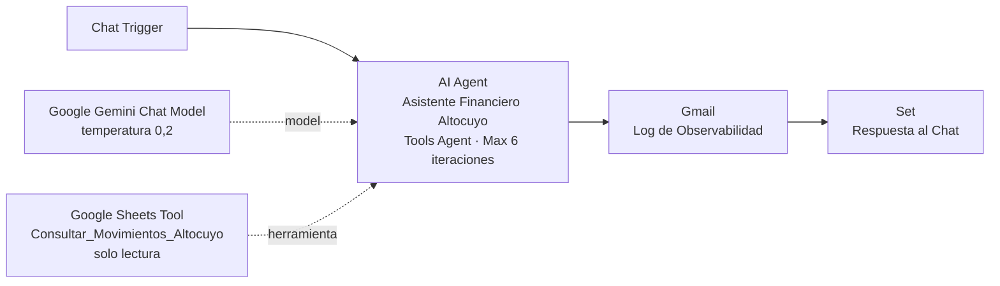

# Asistente Financiero Altocuyo — Proyecto Integrador n8n

Agente de IA construido en **n8n** que responde consultas sobre la situación financiera de **Altocuyo SAS** (comercio exterior e importación, Responsable Inscripto) a partir de su planilla de comprobantes en Google Sheets.

Este repositorio acompaña el curso de Automatización con IA: cada checkpoint extiende el flujo del anterior hasta el Proyecto Final Integrador.

| Checkpoint | Contenido | Estado |
|---|---|---|
| **M1 · Agente base** | Trigger → AI Agent + System Prompt + 1 Tool → Log de observabilidad | ✅ Entregado |
| M2 · Multi-agente | Manager + Workers como sub-workflows | Pendiente |
| M3 · Memoria | Contexto por Session_ID | Pendiente |
| M4 · Integraciones | CRM / Calendario / Workspace vía OAuth2 | Pendiente |
| M5 · RAG | Base documental / vector store | Pendiente |
| M6 · Voz | STT / TTS | Pendiente |

---

## Checkpoint 1 — Agente base y motor de razonamiento

**Archivo:** [`checkpoint1/checkpoint1_mauricio_graziani.json`](checkpoint1/checkpoint1_mauricio_graziani.json)

### Arquitectura

| Nodo | Función |
|---|---|
| **Chat Trigger** | Recibe la consulta en lenguaje natural del usuario. |
| **Asistente Financiero Altocuyo** (AI Agent) | Razona la consulta, decide de forma autónoma si necesita datos y redacta la respuesta. |
| **Google Gemini Chat Model** | Modelo de lenguaje conectado de forma nativa al agente. |
| **Consultar_Movimientos_Altocuyo** (Google Sheets Tool) | Lee la hoja `Movimientos` de la planilla financiera. Conectada lateralmente al agente, nunca en la línea secuencial del flujo. |
| **Log de Observabilidad** (Gmail) | Envía un reporte HTML con la consulta, cada herramienta activada (input y resultado) y la respuesta final. |
| **Respuesta al Chat** (Set) | Devuelve al chat la respuesta del agente. Es necesario porque el Chat Trigger muestra la salida del último nodo, que de otro modo sería la respuesta técnica de Gmail. |

### Cumplimiento de la rúbrica

| Criterio | Implementación |
|---|---|
| **System Prompt claro** | Estructura modular **Rol → Ámbito → Objetivo → Uso de herramientas → Reglas → Escalamiento**. Define qué acciones **no** puede hacer: registrar, editar o borrar datos; inventar cifras; mezclar monedas; atender consultas fuera de Altocuyo SAS. Excluye explícitamente el lenguaje inclusivo. |
| **Herramienta solo cuando corresponde** | Descripción semántica extensa con columnas de la hoja, casos de negocio en los que **debe** activarse (ventas, compras, pendientes de cobro/pago, posición de IVA, detalle por contraparte) y casos en los que **no** (saludos, preguntas conceptuales, pedidos de escritura). Mitiga la "instrucción huérfana". |
| **Límite de iteraciones** | `Max Iterations = 6` en las opciones avanzadas del agente. Protege contra bucles de razonamiento y consumo descontrolado de tokens. |
| **Registro de lo que hizo** | `Return Intermediate Steps = ON`. El mail de log muestra cada paso del agente: herramienta usada, parámetros enviados y resultado obtenido. |

### Pruebas realizadas

| Prompt de prueba | Comportamiento esperado | Resultado |
|---|---|---|
| *"¿Qué tengo pendiente de cobrar?"* | Activa `Consultar_Movimientos_Altocuyo`, filtra por saldo y responde con cifras. El log registra 1 paso. | ✅ |
| *"¿Qué diferencia hay entre una factura A y una B?"* | Responde sin activar la herramienta. El log indica "sin herramientas". | ✅ |

La diferencia entre ambos casos demuestra que el agente decide de forma probabilística cuándo abrir la rama de la herramienta.

### Notas técnicas

- **Modo Tools Agent.** En las versiones recientes de n8n el nodo AI Agent ya no muestra el selector de tipo de agente: funciona como Tools Agent por defecto. El JSON incluye `"agent": "toolsAgent"` de forma explícita.
- **Modelo.** Se usa **Google Gemini** mediante su nodo nativo (`lmChatGoogleGemini`). Gemini soporta *function calling*, requisito para el modo Tools Agent. Reemplazarlo por OpenAI o Anthropic implica cambiar un solo nodo, sin tocar el resto del flujo.
- **Formato numérico.** La herramienta lee los valores sin formato (`UNFORMATTED_VALUE`) para que los montos lleguen como números y no como texto con formato argentino ("89.000,00"), lo que evita errores de cálculo.

### Cómo importarlo

1. En n8n: **Workflows → Import from File** y seleccionar el JSON.
2. Reemplazar los placeholders:
   - `TU_SHEET_ID_ALTOCUYO`: ID de la planilla de Google Sheets.
   - `TU_EMAIL_DE_LOG`: casilla que recibe el log de observabilidad.
3. Asignar credenciales propias en los nodos de Gemini, Google Sheets y Gmail.
4. Abrir el chat del Chat Trigger y enviar un prompt de prueba.

> **Seguridad:** el JSON exportado de n8n no contiene claves, tokens ni contraseñas; solo el ID interno y el nombre de cada credencial. Los identificadores de la planilla y la casilla de correo se reemplazaron por placeholders antes de publicar.

---

## Resiliencia: patrón Circuit Breaker

El agente depende de dos servicios externos (la API de Gemini y la API de Google Sheets). El patrón **Circuit Breaker** evita que una falla externa se propague o genere reintentos infinitos:

| Estado | Comportamiento |
|---|---|
| **Cerrado** | Operación normal: las llamadas pasan. |
| **Abierto** | Tras N fallas consecutivas (por ejemplo, error 429 de cuota de Gemini), se dejan de hacer llamadas durante un tiempo y se responde con un mensaje de servicio no disponible. |
| **Semiabierto** | Pasado ese tiempo, se deja pasar una llamada de prueba. Si funciona, el circuito se cierra; si falla, vuelve a abrirse. |

**En este checkpoint** ya hay dos protecciones de la misma familia: el límite de 6 iteraciones (corta bucles internos) y la regla del System Prompt que obliga al agente a informar la falla de la herramienta en lugar de inventar cifras. **Evolución prevista:** contador de fallas en la memoria del proyecto (M3), Error Trigger con notificación y reintentos con espera configurados en los nodos externos.

---

## Glosario técnico

| Término | Definición |
|---|---|
| **Agente de IA** | Sistema que usa un modelo de lenguaje para decidir qué acciones ejecutar para cumplir un objetivo, en lugar de seguir un camino fijo. |
| **Tools Agent** | Tipo de agente que puede invocar herramientas externas (planillas, correo, APIs) mediante *function calling*. |
| **Ciclo ReAct** | *Reason + Act*: el agente alterna razonamiento, acción (uso de una herramienta) y observación del resultado hasta llegar a una respuesta. |
| **System Prompt** | Instrucciones fijas que definen rol, alcance y límites del agente en todas las conversaciones. |
| **Function calling** | Capacidad del modelo de devolver una llamada estructurada a una función en vez de texto libre. |
| **Instrucción huérfana** | Herramienta disponible cuya descripción no explica cuándo usarla; el modelo la ignora o la usa mal. |
| **Guardrail** | Límite técnico o de comportamiento que acota lo que el agente puede hacer (por ejemplo, Max Iterations). |
| **Max Iterations** | Cantidad máxima de ciclos razonamiento-acción por consulta. Evita bucles y controla el costo. |
| **Intermediate Steps** | Registro de cada paso del agente: herramienta usada, input y resultado. Base de la observabilidad. |
| **Observabilidad** | Capacidad de reconstruir qué hizo el sistema y por qué, a partir de sus registros. |
| **Token** | Unidad mínima de texto que procesa un modelo. Determina costo y límites de cuota. |
| **Latencia** | Tiempo entre el envío de la consulta y la respuesta. Aumenta con cada iteración y con el volumen de datos leídos. |
| **Temperatura** | Parámetro que regula la variabilidad de las respuestas. Un valor bajo (0,2) prioriza exactitud y consistencia. |
| **Alucinación** | Respuesta del modelo que parece correcta pero no está respaldada por datos reales. |
| **Webhook** | URL que recibe datos de otro sistema en el momento en que ocurre un evento. |
| **OAuth2** | Protocolo de autorización que permite a n8n acceder a servicios de Google sin almacenar la contraseña del usuario. |
| **Idempotencia** | Propiedad de una operación que produce el mismo resultado aunque se ejecute más de una vez. Clave al sumar escrituras en próximos módulos. |
| **Rate limit (error 429)** | Límite de solicitudes por minuto que impone un proveedor de API. |
| **Circuit Breaker** | Patrón de resiliencia que corta temporalmente las llamadas a un servicio que está fallando. |

---

**Autor:** Mauricio Graziani
